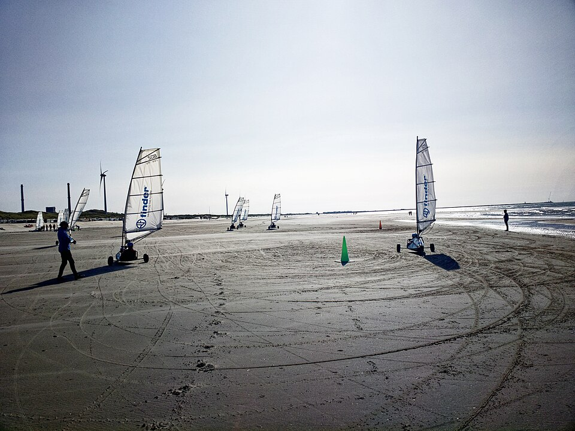

# ⛵ Sail Cart (Land Yacht) — Full Build Parts List

A complete shopping list for building a one-seat, three-wheel sail cart from
zero. It uses metric sizes that Israeli metal and hardware shops (like M&M)
stock. Hebrew shop names are in brackets so you can show this list at the
counter.

> **Updated design:** this was the first concept list. The final, reviewed
> design (reinforced head tube, mast-step base plate, wheel-plate base plates,
> 6 mm fork bridge, grade 8.8 axles, cable steering with turnbuckles) is in the
> 3D build-guide app at [`app/index.html`](app/index.html). Where they differ,
> follow the app.


*This is the build you're aiming for: a low steel frame, three pneumatic wheels,
a sling seat, a free-standing mast and a windsurf-type sail. Photo: Brian
MacIntosh, [Wikimedia Commons](https://commons.wikimedia.org/wiki/File:Land_Sailing_-_El_Mirage.JPG), CC BY-SA 4.0.*



*Club-class carts on the beach. Note the wide rear axle, the steering front
wheel and the full-batten sails. Photo: Txllxt TxllxT, [Wikimedia Commons](https://commons.wikimedia.org/wiki/File:Land_Sailing_on_the_North_Sea_Beach_at_Wijk_aan_Zee,_North_Holland_1.jpg), CC BY-SA 4.0.*

---

## The design (so the list makes sense)

```
                 SAIL + MAST
                     |
   [front wheel]==[mast step]======== spine (2.3 m) ========[seat]
     steers with       |                                      |
     your feet         |                                      |
                       |                       [rear wheel]===+=== rear axle (1.7 m) ===[rear wheel]
```

| Dimension | Value |
|---|---|
| Wheelbase (front axle → rear axle) | ~2.0 m |
| Track (rear wheel to rear wheel) | ~1.6 m |
| Mast height | ~4.3–4.6 m |
| Sail area | 4.5–5.5 m² (beginner / adult up to ~90 kg) |
| Steering | Front wheel on a fork, steered with your feet on a foot bar |
| Frame | Welded steel square tube (or bolted, see the bolts section) |

---

## 1. Steel frame — `פרופילים / צינורות ברזל`

Shops sell steel in 6 m lengths. Buy the lengths below and cut them yourself, or
ask the shop to cut them.

| # | Part | Material [Hebrew] | Cut length | Qty |
|---|---|---|---|---|
| 1 | Main spine (backbone) | Square tube 50×50×2.5 mm [צינור מרובע] | 2.30 m | 1 |
| 2 | Rear axle beam | Square tube 50×50×2.5 mm | 1.70 m | 1 |
| 3 | Diagonal braces (spine → rear beam) | Square tube 30×30×2 mm | 0.90 m | 2 |
| 4 | Seat frame / back support uprights | Square tube 30×30×2 mm | 0.60 m | 2 |
| 5 | Seat cross bars | Square tube 30×30×2 mm | 0.45 m | 3 |
| 6 | Mast step socket (mast stands in it) | Round tube Ø60×3 mm [צינור עגול] (fit to your mast foot) | 0.25 m | 1 |
| 7 | Mast step gussets (support plates) | Flat plate 5 mm [פח / פלטה] | 150×100 mm | 4 |
| 8 | Front steering head tube | Round tube Ø32×3 mm | 0.15 m | 1 |
| 9 | Front fork legs | Flat bar 40×6 mm [פלח] | 0.35 m | 2 |
| 10 | Fork top bridge | Flat bar 40×6 mm | 0.15 m | 1 |
| 11 | Foot steering bar | Square tube 25×25×2 mm | 0.60 m | 1 |
| 12 | Rear wheel stub-axle plates | Flat plate 6 mm | 100×80 mm | 4 |
| 13 | Axles (front + 2 rear) | Solid round bar Ø20 mm [מוט עגול מלא] (match wheel bore) | 0.25 m | 3 |
| 14 | Sheet-block mounting tab | Flat bar 30×5 mm | 80 mm | 2 |
| 15 | Tube end caps | Plastic caps 50×50 and 30×30 [פקקים לפרופיל] | — | 8 |

**What to buy from the shop:**
- 50×50×2.5 square tube: **1 length of 6 m** (covers spine and rear beam, with spare)
- 30×30×2 square tube: **1 length of 6 m**
- 25×25×2 square tube: **1 m**
- Ø60×3 round tube: **0.3 m**. Take your mast foot with you and check the fit before you buy.
- Ø32×3 round tube: **0.2 m**
- 40×6 flat bar: **1 m**
- 30×5 flat bar: **0.5 m**
- 5 mm and 6 mm plate offcuts: **about 0.3 × 0.3 m each**
- Ø20 solid round bar: **1 m**

> **Lighter option:** build the spine and rear beam from 60×60×3 aluminium tube
> instead. It's about 40% lighter, but you must bolt it, not weld it, unless you
> can weld aluminium (TIG).

---

## 2. Wheels & bearings — `גלגלים ומיסבים`

| Part | Spec | Qty |
|---|---|---|
| Pneumatic wheels | 4.00-8 or 3.50-8 (Ø ~380–400 mm) wheelbarrow or trolley wheels with built-in bearings, **Ø20 mm bore** [גלגל מריצה/עגלה עם מיסב] | 3 (+1 spare) |
| Spare inner tubes | Same size [פנימית] | 2 |
| Wheel spacers / bushings | Ø20 ID steel spacer, 10–20 mm long [ספייסר / תותב] | 6 |
| Axle retaining | Ø20 shaft collars with grub screw [טבעת עצירה], **or** drill and use R-clips / cotter pins | 6 |
| Steering pivot bushings | Bronze or nylon bushing, Ø20 ID × Ø26 OD to fit inside the Ø32 head tube [תותב ברונזה/ניילון] | 2 |
| Grease | Bearing grease [גריז] | 1 tube |

> Bigger and wider tires = better on sand: go for the widest 4.00-8 "balloon"
> tire you can find. Only ride where it is allowed: not on swimming beaches,
> not near people, and not in nature reserves.

---

## 3. Bolts, nuts & fasteners — `ברגים, אומים ודסקיות`

Use **galvanized or stainless (A2/A4)** hardware. You'll be on sand and in salt
air. Always use **nylock nuts** [אום נעילה / ניילוק] on anything that moves or
vibrates.

| Use | Bolt | Nuts | Washers | Qty |
|---|---|---|---|---|
| Steering pivot (kingpin through head tube) | M20×200 hex bolt (or the Ø20 bar threaded) | M20 nylock | M20 large flat ×2 | 1 set |
| Front axle through fork | M20 bolt or Ø20 bar | M20 nylock ×2 (if threaded) | M20 ×4 | 1 set |
| Rear axle beam → spine (if bolted) | M10×80 | M10 nylock | M10 flat ×2 each | 4 |
| Diagonal braces (if bolted) | M8×60 | M8 nylock | M8 flat ×2 each | 4 |
| Seat frame → spine | M8×60 | M8 nylock | M8 flat ×2 each | 6 |
| Mast step gussets (if bolted) | M10×70 | M10 nylock | M10 flat ×2 each | 4 |
| Foot bar → fork | M8×50 | M8 nylock | M8 flat ×2 each | 2 |
| Rear stub-axle plates | M10×40 | M10 nylock | M10 flat ×2 each | 8 |
| Sheet blocks / shackles / pad-eyes | M6×30 | M6 nylock | M6 large (fender) ×2 each | 8 |
| Seat fabric / board → frame | M6×25 button-head | M6 nylock | M6 fender ×2 each | 10 |
| Axle pins | Cotter pins 4×40 mm or R-clips [שגם / סיכה] | — | — | 10 |
| Spare kit | Assorted M6 / M8 / M10 | | | 1 box |

**Shopping totals (round up):**
- M6: 20 bolts, 20 nylocks, 40 fender washers
- M8: 15 bolts, 15 nylocks, 30 washers
- M10: 20 bolts, 20 nylocks, 40 washers
- M20: 2 bolts (or thread your Ø20 bar), 4 nylocks, 8 washers
- Thread-locker (Loctite 243 blue) [דבק הברגה]: 1

---

## 4. Mast, boom & sail — the rig `תורן, בום ומפרש`

The easiest and best route: **use a used windsurf rig** (mast + boom + sail +
extension). It's light, strong and made for exactly this kind of wind. Look on
Yad2 or at a windsurf shop (Sdot Yam, Tel Aviv, Eilat). Ask M&M for the metal
parts only.

| Part | Spec | Qty | Where |
|---|---|---|---|
| Sail | Windsurf sail 4.5–5.5 m², with battens [מפרש גלשן רוח] | 1 | Windsurf shop / Yad2 |
| Mast | Windsurf mast to match the sail's luff (usually 430 or 460 cm), RDM or SDM | 1 | Windsurf shop / Yad2 |
| Mast extension | Windsurf extension, sized for the sail | 1 | Windsurf shop |
| Mast foot insert | Wood or nylon plug turned to fit **inside the Ø60 mast step**, with the extension sitting in it, so the mast can rotate | 1 | Make it / turner [חרט] |
| Boom | Windsurf boom sized for the sail | 1 | Windsurf shop / Yad2 |
| Downhaul rope | 6 mm pre-stretched rope, 3 m | 1 | Marine / hardware |
| Outhaul rope | 5 mm rope, 2 m | 1 | Marine / hardware |

**Metal-shop alternative (if you build the mast yourself):**
- Mast: aluminium round tube Ø50×2 mm, 2 × 2.3 m, joined with a 0.4 m Ø46 internal sleeve and riveted. Add 3 stays of 3 mm stainless wire with turnbuckles [מותח / טרנבקל] and thimbles + wire clamps [מהדק כבל] ×9.
- Boom: aluminium tube Ø32×2 mm, 2.2 m
- Sail: have a sailmaker cut one from 170 g Dacron, about 5 m². A tarp sail does work, but it stretches and won't point upwind.

---

## 5. Sheet (sail control) & running rigging — `חבלים וגלגלות`

| Part | Spec | Qty |
|---|---|---|
| Mainsheet rope | 8–10 mm braided polyester, soft hand [חבל קלוע] | 8 m |
| Ratchet block (on the spine, near your hand) | 40–57 mm ratchet block | 1 |
| Single blocks | 40 mm single block with shackle [גלגלת] | 2 |
| Boom-end block | 40 mm single block with becket | 1 |
| Cam cleat with fairlead | Medium cam cleat [תפס/קאם] | 1 |
| Shackles | 6 mm stainless D-shackles [שאקל] | 4 |
| Pad-eyes | Stainless pad-eye, M6 | 4 |
| Stopper ball | For the end of the sheet | 1 |
| Spare line | 5 mm cord for lashings | 5 m |

---

## 6. Seat & driver — `מושב`

| Part | Spec | Qty |
|---|---|---|
| Seat option A (simple) | Plastic bucket seat (kart seat) [מושב קארטינג] | 1 |
| Seat option B (classic sling) | Heavy canvas or PVC tarp 1.0 × 0.6 m, with brass grommets, laced to the seat frame with 5 mm cord | 1 |
| Seat option C (board) | 18 mm marine plywood [סנדוויץ' / דיקט ימי] 0.45 × 0.5 m seat + 0.45 × 0.4 m back, plus a foam pad | 1 |
| Seat belt / lap belt | Kart or car lap belt with buckle [חגורת בטיחות] | 1 |
| Belt mounting | M8 eye bolts + nylocks | 2 |
| Foot pegs / pads | Rubber pads on the foot bar | 2 |

---

## 7. Paint & finish — `צבע וגימור`

| Item | Qty |
|---|---|
| Rust-proof primer (zinc / epoxy) [צבע יסוד] | 1 L or 2 spray cans |
| Top coat, enamel (bright, so you're visible) [לכה / אמאייל] | 1 L or 3 spray cans |
| Degreaser / thinner [טרפנטין / מדלל] | 1 L |
| Sandpaper 80 / 120 / 240 [נייר לטש] | 5 of each |
| Reflective tape | 2 m |

---

## 8. Workshop consumables — `מתכלים`

| Item | Qty |
|---|---|
| Welding electrodes 2.5 mm (6013) [אלקטרודות] or MIG wire | 2 kg |
| Cutting discs 115 mm [דיסק חיתוך] | 10 |
| Grinding / flap discs 115 mm [דיסק ליטוש] | 3 |
| HSS drill bits 6, 8, 10, 12 mm (step-drill to 20 mm) [מקדחים] | 1 set |
| Tap & die M6 / M8 / M10 (if threading) | 1 set |
| Pop rivets 4.8 mm aluminium + rivet gun (for an aluminium mast) [ניטים] | 20 |
| Cable ties [אזיקונים] | 1 pack |

Tools you need on hand: angle grinder, welder (or have a welder [רתך] tack it
for you), drill (a drill press is better), tape measure, square, spirit level,
spanners 10/13/17/30 mm, and a tire pump.

---

## 9. Safety gear — `ציוד בטיחות` (don't skip this)

| Item | Qty |
|---|---|
| Helmet (bike, skate or kart) [קסדה] | 1 |
| Sailing or work gloves [כפפות] | 1 pair |
| Sunglasses / goggles (blowing sand) | 1 |
| Elbow & knee pads | 1 set |
| Wind meter (optional, for learning) | 1 |

---

## Build order (short version)

1. Cut and weld the **spine + rear axle beam** into a T. Check it's square, then add the diagonal braces.
2. Weld the **mast step** (Ø60 socket + 4 gussets) on top of the spine, ~0.4 m behind the front wheel.
3. Build the **front fork + head tube**, fit the bushings and kingpin, and weld on the foot bar.
4. Weld the **rear stub-axle plates** at the ends of the rear beam, then fit the axles and wheels.
5. Build the **seat frame** at the rear of the spine, just ahead of the rear axle.
6. Fit the **pad-eyes and blocks** for the mainsheet (boom → rear beam → ratchet block → your hand).
7. Prime and paint everything.
8. Step the **mast**, rig the sail, and test in **light wind (8–12 knots)** on an empty, flat area first.

---

## Sources & further reading

- [Land sailing — Wikipedia](https://en.wikipedia.org/wiki/Land_sailing)
- [Instructables — Land Yacht build](https://www.instructables.com/Land-Yacht/)
- [Seabreeze — Building a land yacht (forum thread)](https://www.seabreeze.com.au/forums/Land-Yacht-Sailing/Construction/Building-a-Landyacht-for-DesignandTech-Major-Work?page=2)
- [Seabreeze — Plans for Jesse's land yacht](https://www.seabreeze.com.au/Photos/View/13788/Land%20Yachting/Plans-for-Jesses-landyacht/)
- Photos: [El Mirage](https://commons.wikimedia.org/wiki/File:Land_Sailing_-_El_Mirage.JPG) and [Wijk aan Zee](https://commons.wikimedia.org/wiki/File:Land_Sailing_on_the_North_Sea_Beach_at_Wijk_aan_Zee,_North_Holland_1.jpg) on Wikimedia Commons (CC BY-SA 4.0)
