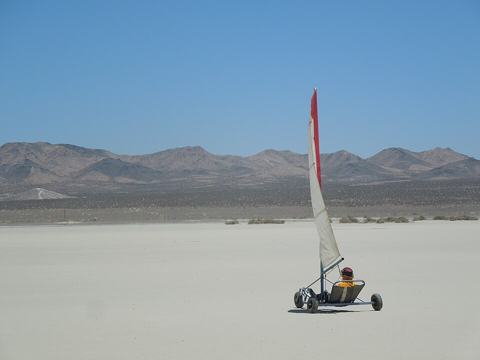

# 🛒 רשימת קניות לעגלת מפרש — מה לקנות ב-מ.נ.מ ומה במקומות אחרים

רשימה מלאה לבניית עגלת מפרש (Land Yacht) לאדם אחד, שלושה גלגלים.
סמן ☐ ← ✅ כשקנית.

---

## 🟠 חלק א' — מה קונים ב-מ.נ.מ

**מ.נ.מ — כלי עבודה, ציוד טכני ופתרונות DIY** · [mnmltd.co.il](https://www.mnmltd.co.il) · ☎ 09-9735200
- **סניף כפר סבא** — רח' השיטה 4 (סניף הדגל, חניה חינם)
- **סניף רעננה** — רח' התעשייה 7

> בדקתי באתר שלהם (אוקטובר 2026). מה שמסומן **✔ באתר** — ראיתי אותו באתר.
> מה שמסומן **❓ לשאול** — כנראה יש בסניף (יש להם מחלקת ברגייה), אבל לא מופיע באתר. תתקשר לפני.

### 🔩 ברגים ומוטות הברגה

| ✅ | מה לבקש | כמה | באתר? |
|---|---|---|---|
| ☐ | **מוט הברגה מגולוון 20 מ"מ** — ישמש לצירי הגלגלים ולציר ההגה (במקום מוט מלא) | 1 מטר | ✔ באתר |
| ☐ | **מוט הברגה 10 מ"מ** (גיבוי לחיבורים ארוכים) | 1 מטר | ✔ באתר |
| ☐ | בורג משושה מגולוון **M6** × 25–30 מ"מ | 20 | ❓ לשאול |
| ☐ | בורג משושה מגולוון **M8** × 50–60 מ"מ | 15 | ❓ לשאול |
| ☐ | בורג משושה מגולוון **M10** × 40 / 70 / 80 מ"מ | 20 | ❓ לשאול |
| ☐ | **אום נעילה (ניילוק)** M6 / M8 / M10 / M20 | 20 / 15 / 20 / 6 | ❓ לשאול |
| ☐ | **דסקיות** M6 רחבות / M8 / M10 / M20 | 40 / 30 / 40 / 8 | ❓ לשאול |
| ☐ | **בורג עין M8** (לחגורת בטיחות) | 2 | ❓ לשאול |
| ☐ | **שגמים / סיכות R** | 10 | ❓ לשאול |
| ☐ | **לוקטייט** (דבק הברגה) | 1 | ✔ באתר |
| ☐ | **אזיקונים** | חבילה | ✔ באתר |

### ⛓️ כבלים, שאקלים וקשירה

| ✅ | מה לבקש | כמה | באתר? |
|---|---|---|---|
| ☐ | **שאקל אומגה** תקני (מידה 7/16) — לחיבור גלגלות וחבלים | 4 | ✔ באתר |
| ☐ | **כבל פלדה מגולוון 3 מ"מ** — רק אם בונים תורן לבד (תמיכות) | 15 מטר | ✔ באתר |
| ☐ | **לוחץ טלורית** 1–3 מ"מ + טלוריות — לסגירת קצוות הכבל | 1 + 9 טלוריות | ✔ באתר |
| ☐ | **רצועת קשירה עם ראצ'ט** — להובלת העגלה ברכב/נגרר | 2 | ✔ באתר |
| ☐ | **מותחני גומי לקשירה** (סט) — לקשור תורן ומפרש בהובלה | 1 סט | ✔ באתר |

> ⚠️ **חבלים:** במ.נ.מ יש בעיקר חבלי כביסה — **לא מתאים** לחבל השליטה במפרש. את החבלים קונים בחנות ציוד ימי (חלק ב').

### 🔥 ריתוך, חיתוך וקידוח

| ✅ | מה לבקש | כמה | באתר? |
|---|---|---|---|
| ☐ | **רתכת אלקטרודות אינוורטר 160–200A** (אם אין לך — או שתשלם לרתך) | 1 | ✔ באתר |
| ☐ | **אלקטרודות 2.5 מ"מ (6013)** | 2 ק"ג | ❓ לשאול |
| ☐ | **מסכת ריתוך** + **כפפות ריתוך** | 1 | ❓ לשאול |
| ☐ | **משחזת זווית 115 מ"מ** | 1 | ✔ באתר |
| ☐ | **דיסקים לחיתוך ברזל 115 מ"מ** (דקים, 1 מ"מ) | 10 | ✔ קטגוריה באתר |
| ☐ | **דיסק פלאפ / ליטוש 115 מ"מ** | 3 | ✔ קטגוריה באתר |
| ☐ | **מקדח מדורג 4–32 מ"מ** — לפתוח חורים של 20 מ"מ לצירים | 1 | ✔ באתר |
| ☐ | **סט מקדחי HSS לברזל** 6 / 8 / 10 / 12 מ"מ | סט | ✔ קטגוריה באתר |
| ☐ | **אקדח ניטים** + ניטים 4.8 מ"מ (רק לתורן אלומיניום) | 1 | ✔ באתר |
| ☐ | **מלחציים / קליבות** — להחזיק חלקים בזמן ריתוך | 2–4 | ✔ קטגוריה באתר |
| ☐ | **זווית ריתוך מגנטית** (זוויות) | 2 | ✔ קטגוריה באתר |

### 🎨 צבע וגימור

| ✅ | מה לבקש | כמה | באתר? |
|---|---|---|---|
| ☐ | **ממיר חלודה** | 1 | ✔ באתר |
| ☐ | **צבע יסוד פריימר X** | 1 | ✔ באתר |
| ☐ | **המרייט / המרטון — צבע למתכת** (0.75 ליטר) — עמיד, הולך ישר על ברזל | 1–2 | ✔ באתר |
| ☐ | **ספריי שאבי שיק** — לתיקונים וצבע בולט | 2–3 | ✔ באתר |
| ☐ | **נייר לטש** 80 / 120 / 240 | 5 מכל סוג | ✔ קטגוריה באתר |
| ☐ | **מדלל / טרפנטין** | 1 ליטר | ❓ לשאול |

### 🛠️ אחזקה ובטיחות

| ✅ | מה לבקש | כמה | באתר? |
|---|---|---|---|
| ☐ | **תרסיס גריז** (לוקטייט 8109 או M204 לבן) — לצירים ולמיסבים | 1 | ✔ באתר |
| ☐ | **כפפות עבודה** | 2 זוגות | ✔ באתר |
| ☐ | **משקפי מגן** (לחיתוך + חול עף בנסיעה) | 1 | ✔ קטגוריה "בטיחות בעבודה" |
| ☐ | **אטמי אוזניים** (למשחזת) | 1 | ✔ קטגוריה באתר |
| ☐ | **מטר + זווית + פלס** | 1 מכל | ✔ קטגוריה באתר |
| ☐ | **מפתחות** 10 / 13 / 17 / 30 מ"מ | סט | ✔ קטגוריה באתר |

---

## ⚪ חלק ב' — מה **אין** במ.נ.מ, וצריך לקנות במקום אחר

### 🏭 1. ספק ברזל / מחסן ברזל (לא מ.נ.מ!)

מ.נ.מ היא חנות כלי עבודה — **אין שם פרופילי ברזל**. צריך ספק ברזל (מחסן ברזל / "ברזל לבנייה")
— יש כמה באזורי התעשייה של כפר סבא, רעננה, הוד השרון וחולון. ברזל נמכר במוטות של **6 מטר**, ובדרך כלל יחתכו לך.

| ✅ | מה לבקש | מידה | כמה |
|---|---|---|---|
| ☐ | **צינור מרובע** (פרופיל) — שדרה + ציר אחורי | 50×50 עובי 2.5 מ"מ | מוט 6 מטר |
| ☐ | **צינור מרובע** — חיזוקים ומסגרת מושב | 30×30 עובי 2 מ"מ | מוט 6 מטר |
| ☐ | **צינור מרובע** — מוט הגה לרגליים | 25×25 עובי 2 מ"מ | 1 מטר |
| ☐ | **צינור עגול** — בית התורן | קוטר 60 עובי 3 מ"מ | 30 ס"מ (*לבדוק עם רגל התורן!*) |
| ☐ | **צינור עגול** — ציר ההגה | קוטר 32 עובי 3 מ"מ | 20 ס"מ |
| ☐ | **פלח** (ברזל שטוח) — מזלג קדמי | 40×6 מ"מ | 1 מטר |
| ☐ | **פלח** — אוזניים לגלגלות | 30×5 מ"מ | 50 ס"מ |
| ☐ | **פלטות** 5 מ"מ ו-6 מ"מ (שאריות) | 30×30 ס"מ | 1 מכל |
| ☐ | **פקקי פלסטיק לפרופיל** 50×50 ו-30×30 | — | 4 מכל |

### 🛞 2. גלגלים ומיסבים (חנות גלגלים / מיסבים / חקלאות)

באתר של מ.נ.מ לא מצאתי גלגלי מריצה בודדים — שווה לשאול בטלפון, אבל כנראה תצטרך חנות גלגלים.

| ✅ | מה לבקש | כמה |
|---|---|---|
| ☐ | **גלגל אוויר למריצה/עגלה 4.00-8** עם **מיסב לציר 20 מ"מ** | **4** (3 + ספייר) |
| ☐ | **פנימית** לאותו גלגל | 2 |
| ☐ | **ספייסר / תותב** פלדה, פנימי 20 מ"מ | 6 |
| ☐ | **טבעת עצירה** (קולר) לציר 20 מ"מ | 6 |
| ☐ | **תותב ברונזה/ניילון** 20×26 מ"מ (לציר ההגה) | 2 |

### ⛵ 3. מפרש, תורן ובום — יד 2 / חנות גלישת רוח

| ✅ | מה לבקש | כמה |
|---|---|---|
| ☐ | **מפרש גלשן רוח** 4.5–5.5 מ"ר | 1 |
| ☐ | **תורן גלשן** מתאים (430 או 460 ס"מ) | 1 |
| ☐ | **מאריך תורן** | 1 |
| ☐ | **בום** מתאים למפרש | 1 |

### 🪢 4. ציוד ימי / שייט — חבלים וגלגלות

| ✅ | מה לבקש | כמה |
|---|---|---|
| ☐ | **חבל קלוע** 8–10 מ"מ (שליטה במפרש) | 8 מטר |
| ☐ | **חבל** 6 מ"מ + 5 מ"מ (מתיחת מפרש) | 3 + 7 מטר |
| ☐ | **גלגלת ראצ'ט** 40–57 מ"מ | 1 |
| ☐ | **גלגלת בודדת** 40 מ"מ | 2 |
| ☐ | **גלגלת עם עין** 40 מ"מ (קצה הבום) | 1 |
| ☐ | **תפס קאם** (Cam Cleat) | 1 |
| ☐ | **עין קיבוע (Pad-eye)** נירוסטה | 4 |

### 💺 5. מושב (חנות קארטינג / חלקי רכב / נגרייה)

| ✅ | מה לבקש | כמה |
|---|---|---|
| ☐ | **מושב קארטינג** — או ברזנט עבה עם אילתות — או דיקט ימי 18 מ"מ | 1 |
| ☐ | **חגורת בטיחות** (מותן) | 1 |

### 🪖 6. קסדה (חנות אופניים / ספורט)

| ✅ | מה לבקש | כמה |
|---|---|---|
| ☐ | **קסדה** (אופניים / סקייט / קארטינג) | 1 |
| ☐ | **מגני ברכיים ומרפקים** | סט |

---

## 📋 מסלול קניות מסוכם

1. **מ.נ.מ (כפר סבא / רעננה)** — ברגים, מוט הברגה 20 מ"מ, שאקלים, כבל פלדה, כלי ריתוך וחיתוך, דיסקים, מקדחים, צבע, גריז, כפפות. **תתקשר קודם (09-9735200)** ותשאל על ברגים M6/M8/M10 + ניילוקים + אלקטרודות.
2. **ספק ברזל** — כל הפרופילים, הצינורות, הפלח והפלטות.
3. **חנות גלגלים / מיסבים** — 4 גלגלים, פנימיות, ספייסרים, טבעות עצירה.
4. **יד 2 / חנות גלישת רוח** — מפרש, תורן, מאריך, בום.
5. **חנות ציוד ימי** — חבלים, גלגלות, תפס.
6. **מושב + חגורה + קסדה.**

> לפרטים טכניים מלאים (מידות חיתוך, איפה כל בורג הולך, סדר בנייה) — ראה [README.md](README.md).
